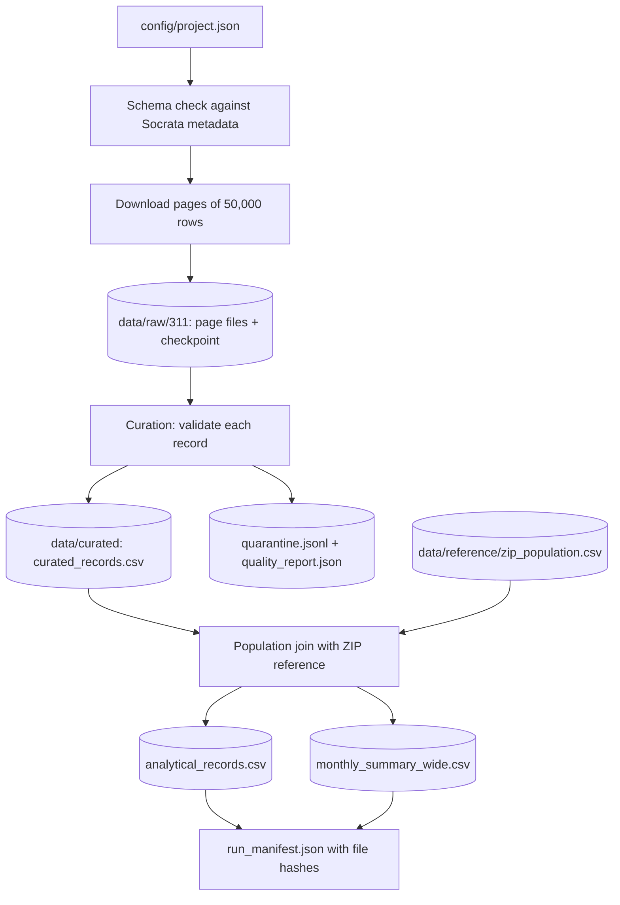

# NYC 311 Data Factory: How This Project Works

This document explains the project in plain language, for someone who has not
read the code yet. It describes what the project does, how the pieces fit
together, how to run it, and what is still missing. The README has the short
run instructions; the checklist has the full requirements status.

## 1. What the project does

New York City publishes every 311 service request (complaints and non-emergency
requests to the city) through a public API called Socrata. Each record is one
resident's call, for example about a broken heater.

This project is a small, repeatable "data factory". It:

1. **Downloads** all NYC 311 requests of one complaint type (`HEAT/HOT WATER`)
   created between 2024-01-01 and 2025-07-01, page by page.
2. **Cleans and validates** each record. Bad records are kept aside in a
   quarantine file instead of being silently dropped.
3. **Joins** the cleaned records to an independent ZIP-code population table, so
   complaints can be compared per resident instead of as raw counts.
4. **Summarizes** complaints by borough and month, with counts, median closure
   time, and complaints per 10,000 residents.
5. **Records** what happened in a run manifest: timings, row counts, the code
   version, and a SHA-256 hash of every output file.

The project is "Stage 1" of a larger course challenge. The brief asks for a
reproducible pipeline, a Jupyter notebook that tells the story, and a written
report that explains the decisions. The notebook and report are not finished yet.

## 2. The data

| Item | Value |
| --- | --- |
| Source | NYC Open Data, 311 Service Requests dataset (`erm2-nwe9`) |
| Endpoint | `https://data.cityofnewyork.us/resource/erm2-nwe9.json` |
| Complaint type | `HEAT/HOT WATER` |
| Date range | `created_date` from 2024-01-01 (included) to 2025-07-01 (excluded) |
| Matching records | 427,458 (live count on 2026-10-22, and again on 2026-10-24) |
| Target minimum | 300,000 raw rows (from `config/project.json`) |

Only these fields are downloaded: `unique_key`, `created_date`, `closed_date`,
`agency`, `complaint_type`, `descriptor`, `incident_zip`, `borough`.

## 3. The pipeline at a glance



The full online run (`run_factory` in `factory.py`) checks the population file,
then validates live schema metadata before downloading. That metadata request
returned HTTP 403. The explicit `--offline` mode instead requires a complete
local checkpoint, skips all source requests, and records the skipped schema
validation in its manifest; the current cached data has completed this replay.

## 4. Each stage in detail

### 4.1 Configuration (`config/project.json`, `src/nyc311_factory/config.py`)

All settings live in one JSON file: the endpoint, date range, complaint type,
page size, retry rules, file paths, the selected fields, and the expected
source schema. `load_settings()` checks every value (for example, the
endpoint must be HTTPS, and the start date must be before the end date) and
returns an immutable `Settings` object. A bad value raises `ConfigurationError`.

### 4.2 Downloading (`api.py`, `pipeline.py`)

- **Client (`SocrataClient`)**: builds the SoQL query (`$select`, `$where`,
  `$order`, `$limit`, `$offset`). Results are ordered by `created_date` and
  `unique_key`, so paging is stable and rows are neither skipped nor repeated.
- **Retries**: HTTP 429 (rate limit) and 5xx errors are retried with
  exponential backoff. Other 4xx errors fail immediately. Every attempt is
  counted for the request budget.
- **Schema check**: before downloading, the project compares the field types
  reported by the dataset's metadata with `expected_source_schema`. If a field
  disappears or changes type, the run stops (schema drift).
- **Pages and checkpoints (`RawDownloader`)**: each page of up to 50,000 rows
  is saved as `data/raw/311/page_<offset>.json`. After each page, a
  `checkpoint.json` records the next offset. If the run is interrupted, rerunning
  it resumes from the checkpoint. The checkpoint also stores the query settings,
  and the code refuses to resume if those settings changed.

### 4.3 Curation (`curation.py`)

Each raw record goes through a fixed list of checks. The first failing check
gives the reason. Rejected records are written to `quarantine.jsonl` with their
original content and a reason code.

| Check | Reason code if it fails |
| --- | --- |
| Record is a JSON object | `RECORD_NOT_OBJECT` |
| `unique_key` present | `MISSING_UNIQUE_KEY` |
| `created_date` present and parseable | `MISSING_CREATED_DATE`, `INVALID_CREATED_DATE` |
| `created_date` inside the configured range | `CREATED_DATE_OUT_OF_RANGE` |
| `closed_date`, if present, is valid and not before `created_date` | `INVALID_CLOSED_DATE`, `CLOSED_BEFORE_CREATED` |
| `complaint_type` present and matches the configured type | `MISSING_COMPLAINT_TYPE`, `UNEXPECTED_COMPLAINT_TYPE` |
| `borough`, if present, is one of the five boroughs | `INVALID_BOROUGH` |
| `unique_key` not already seen | `DUPLICATE_UNIQUE_KEY` (the first copy is kept) |

Some values are cleaned rather than rejected:

- `borough = "UNSPECIFIED"` is stored as blank.
- A ZIP+4 such as `10001-1234` is reduced to `10001`.
- `N/A`, `NA`, and `00000` become a missing ZIP.

`closure_days` is the time from `created_date` to `closed_date`, in days.

The run fails if more than **5%** of records are quarantined
(`max_quarantine_ratio`). This stops a broken source from producing a
misleading "clean" dataset. The check happens before any output file is
replaced, so a failed run never overwrites good outputs.

### 4.4 Population join (`analytics.py`)

Raw complaint counts are not fair between areas: a dense borough will always
have more complaints. The population join supplies the denominator.

1. `load_population()` reads `data/reference/zip_population.csv`. It must have
   the columns `zip_code`, `population`, and `borough`, one row per 5-digit
   ZIP, with whole-number populations and valid borough names.
2. `build_analysis_outputs()` left-joins each curated record to the population
   table on ZIP. The join uses `validate="many_to_one"`, and the code checks
   that the row count did not change.
3. Records whose ZIP is not in the reference are kept, marked
   `population_matched = False`, and counted as unmatched.
4. The reference borough is compared with the borough in the 311 record. Each
   disagreement is counted as a data-quality finding.
5. The monthly summary uses the **311 borough** as the area. The rate is:

   `rate_per_10k = complaints in that borough and month / borough population × 10,000`

   The borough population is the sum of the population of all its ZIPs in the
   reference table.

The reference file now exists at `data/reference/zip_population.csv`, and the
join has been rerun on 427,458 curated rows. Its ZCTA-to-borough mapping remains
approximate. A full run is blocked by the live schema metadata endpoint
returning HTTP 403; the raw pages and completed download checkpoint are local.

### 4.5 Outputs and manifest (`factory.py`)

Files written to `data/curated/`:

| File | What it contains |
| --- | --- |
| `curated_records.csv` | One row per accepted record |
| `quarantine.jsonl` | Rejected records, one JSON object per line, with the reason |
| `quality_report.json` | Accepted/quarantined counts plus per-column null count/percentage, exact distinct count, and observed min/max (text ranges are lexical) |
| `analytical_records.csv` | Curated records plus population and the borough comparison |
| `monthly_summary_wide.csv` | One row per borough; wide columns such as `count_2024-01`, `median_closure_days_2024-01`, `rate_per_10k_2024-01` |
| `run_manifest.json` | Run times, code version, request count, row counts, and SHA-256 hashes of every output |

The manifest is written last, after every file it describes exists. Writes
use a temporary file and then an atomic rename, so a crash never leaves a
half-written file.

### 4.6 Rolling window (`cli.py`, `--rolling-window-days`)

Instead of a fixed date range, a rolling run covers the period from the last
successful run's end date up to tomorrow. The first run looks back N days.
Each window gets its own raw folder, and the state file is updated only after
the whole run succeeds.

### 4.7 Offline replay (`cli.py`, `--offline`)

Offline replay requires a complete, settings-compatible local checkpoint. It
reprocesses the cached pages without making source requests, including the live
schema request, and records `source_schema_validation: skipped_offline` in the
manifest. It is useful when the source is unreachable, but it does not verify
current source schema or refresh the downloaded data.

## 5. How to run it

Run these from the project root in PowerShell:

```powershell
python -m venv .venv
.\.venv\Scripts\Activate.ps1
python -m pip install -r requirements.txt
python -m pip install -e .

nyc311-factory --count-only        # asks the API how many records match (no download)
nyc311-factory --download-only     # downloads raw pages with checkpoints
nyc311-factory --curate-only       # validates raw pages, writes curated outputs
nyc311-factory --analyze-only      # joins curated records to population (needs the reference CSV)
nyc311-factory --offline           # full local replay (requires a complete checkpoint)
nyc311-factory                     # online full pipeline (needs the reference CSV and API access)

python -m unittest discover -s tests -v   # offline tests
```

The modes `--count-only`, `--download-only`, `--curate-only`, and
`--analyze-only` are mutually exclusive. `--offline` applies only to the full
pipeline and cannot be combined with a single-stage mode or rolling window.
`--analyze-only` also needs `data/curated/curated_records.csv`, which is created
by `--curate-only`.

**Warning:** a full download is about 427,000 records, which means roughly 9
pages of 50,000 rows. Use `--count-only` first to check the number.

### Exit codes

| Code | Meaning |
| --- | --- |
| 0 | Success |
| 1 | Unexpected factory error |
| 2 | Configuration error, including a missing population file |
| 3 | Network error (failed request after retries, or a non-retryable HTTP error) |
| 4 | Data validation error (schema drift, too few rows, too many quarantined records, bad reference file) |
| 5 | Checkpoint error (the checkpoint is corrupt or was made with different settings) |

## 6. Credentials

The NYC Open Data API works without a key, but with a lower request limit.
The code reads two optional environment variables:

- `NYC311_API_KEY_ID`
- `NYC311_API_KEY_SECRET`

They are sent as HTTP Basic authentication when both are set. The project
keeps credentials out of the config and the outputs. The local
`credential.md` file is listed in `.gitignore`, so Git ignores it. You must
set the variables in each terminal session yourself. The code does not read
`credential.md`.

## 7. Current status

Based on `PROJECT_REQUIREMENTS_CHECKLIST.md`:

| Area | Status |
| --- | --- |
| Configuration, validation, download with checkpoints, retries | Implemented; live API requests currently return HTTP 403 from this network |
| Curation with quarantine and quality report | Replayed locally: 427,458 accepted, zero quarantined; per-column metrics regenerated |
| Population join and monthly summary code | Replayed locally on 427,458 records; ZIP matches and borough disagreements recorded |
| Population reference (`data/reference/zip_population.csv`) | 215 NYC ZCTAs with 2024 ACS estimates and documented land-overlap borough approximation |
| Full online run from an empty folder | Not verified; current live schema request returns HTTP 403 |
| Offline replay manifest | Produced with hashes, zero requests, and schema validation marked `skipped_offline` |
| Rolling-window/schema-drift behavior | Offline-tested; live source verification remains blocked by HTTP 403 |
| Notebook (`solution.ipynb`) | EDA code validated headlessly; fresh Jupyter execution and saved chart outputs remain pending |
| Report (`report.md`) | Real analysis results documented; human review remains |
| Git repository and history | Repository initialized but has no commits or required history |

The population reference now uses the public 2024 ACS five-year B01003 table,
NYC's ZCTA list, and the Census 2020 ZCTA-to-county land-area crosswalk. Its
borough assignment is an approximation documented in
`data/reference/README.md` and `report.md`. The remaining online blocker is the
HTTP 403 at the source metadata endpoint; the cached data can be replayed
locally with `nyc311-factory --offline`.

## 8. Files and folders

```
Season_3_project/
├── config/project.json          # all settings
├── src/nyc311_factory/
│   ├── cli.py                   # command-line modes and exit codes
│   ├── config.py                # loads and validates settings
│   ├── api.py                   # Socrata HTTP client, retries, schema check
│   ├── pipeline.py              # paged download with checkpoints
│   ├── curation.py              # record validation and quarantine
│   ├── analytics.py             # population join and monthly summary
│   ├── factory.py               # full pipeline and run manifest
│   └── exceptions.py            # error classes with exit codes
├── tests/                       # offline unittest suite (46 tests)
├── data/
│   ├── raw/311/                 # downloaded pages + checkpoint (not in Git)
│   ├── curated/                 # outputs (not in Git)
│   ├── reference/               # 2024 ACS population CSV + mapping note
├── solution.ipynb               # notebook (partial)
├── report.md                    # written report (draft, in Persian as the course requires)
├── README.md                    # short run instructions
├── PROJECT_REQUIREMENTS_CHECKLIST.md   # full requirement status
├── HUMAN_REVIEW.md              # notes on human review and AI use
├── credential.md                # local API key file (gitignored)
└── requirements.txt / pyproject.toml   # dependencies and package setup
```

## 9. Glossary

- **Socrata**: the platform behind NYC Open Data. Its query language, SoQL,
  uses `$where`, `$select`, `$order`, `$limit`, and `$offset`.
- **Page / offset**: the API returns at most 50,000 rows per request. The
  offset says how many rows to skip first.
- **Checkpoint**: a small file that records how far the download got, so it
  can resume.
- **Quarantine**: a holding area for rejected records, kept with reasons
  instead of being thrown away.
- **ZIP code vs ZCTA**: a ZIP code is a postal delivery route. A ZCTA
  (ZIP Code Tabulation Area) is the Census Bureau's area that approximates
  it. They are not identical, so the population join may leave some ZIPs
  unmatched.
- **MODZCTA**: a Health Department grouping of ZCTAs. It is not the same as a
  ZIP code.
- **Rate per 10,000**: complaints divided by population, times 10,000. It makes
  boroughs of different sizes comparable.
- **Many-to-one join**: many complaint rows can match one ZIP row, but each
  complaint matches at most one population row.
- **Manifest**: a JSON record of one run, with timings, counts, and file hashes,
  so a second run can prove it produced the same files.
