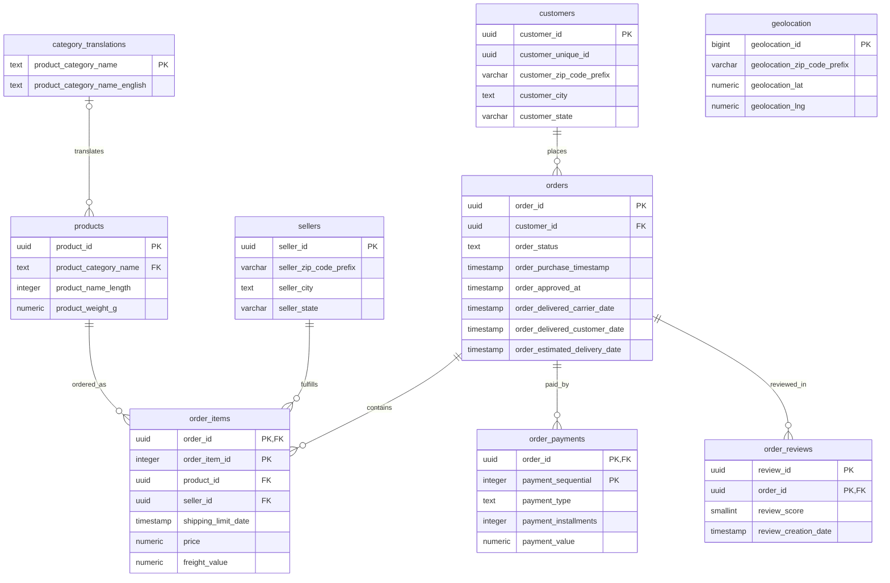
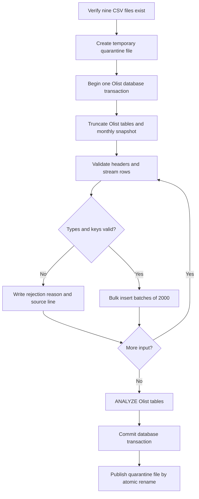

# Stage 2: Database Performance & Architecture Explained

*A walkthrough of the current PostgreSQL implementation and its saved evidence*

## 1. Objective and evidence boundary

Stage 1 curates NYC311 data. Stage 2 models the Olist e-commerce dataset in PostgreSQL, validates its relational integrity, and measures five analytical queries over roughly 100,000 orders from 2016–2018. This is a reproducible local database-performance exercise, not evidence of production readiness or a latency SLA.

The current sources of truth are:

- `solution.ipynb`: saved execution counts **1–11**, with outputs and no error outputs.
- `data/curated/performance_results.json`: generated, Git-ignored measurements from that run. All data/evidence paths in this document are relative to this stage unless stated otherwise.
- `README.md` and `GETTING_STARTED.md`: current setup, build, notebook, and test workflows.
- `sql/queries/`, `sql/migrations/`, and `src/database_performance/`: the implementation being explained.

The selected paths are **Q1 snapshot; Q2–Q5 live SQL**. Q4 is set-based with materialized CTE boundaries, **not a correlated `LATERAL` query**. All five samples for every final query were below 200 ms in the saved run. That does not establish cold-cache, concurrent-load, or future-data performance.

## 2. Relational schema architecture

Two Stage 2 namespaces separate concerns:

- **`olist`** contains nine source-domain tables: customers, sellers, products, category translations, orders, items, payments, reviews, and geolocation.
- **`analytics`** contains reusable views, the delivery-delay function, the monthly snapshot table, its maintenance procedure, and the Python bridge's derived state summary.

The chained Stage 1 load uses its own package and the separate `nyc311.service_requests` table; the saved run reports **427,458 source rows** loaded by idempotent upsert.

### Entity-relationship diagram

The diagram shows key fields, not every column. The SQL definition is `sql/migrations/001_olist.sql`.



Orders can have no child rows; foreign keys do not require an item, payment, or review to exist. Product category is nullable. Geolocation has an identity primary key because source ZIP prefixes and rows repeat; it has **no declared ZIP-prefix foreign key** to customers or sellers.

### Data type decisions

| Concept | Choice | Reason and limitation |
| --- | --- | --- |
| Identifiers | `UUID` | Preserves source identifiers; `customer_unique_id` is not the customer table's primary key. |
| Currency | `NUMERIC(12,2)` | Represents cents without binary floating-point rounding. Q1 merchandise revenue excludes freight; Q5 basket value includes it. |
| Weights and dimensions | `NUMERIC(14,3)` | Stores decimal values in the source units (grams and centimeters); precision does not guarantee source measurement accuracy. |
| Timestamps | `TIMESTAMP` without time zone | Preserves source wall-clock values without inventing UTC offsets. Cross-zone interpretation needs a separate time-zone contract. |
| ZIP prefixes | `VARCHAR(5)` with `^[0-9]{5}$` | Preserves leading zeros such as `01001`. |
| Review key | `(review_id, order_id)` | A review ID can occur against multiple orders in the source. |

Checks also constrain statuses, nonnegative monetary/physical values, state-code format, and review scores. Database constraints remain in force after Python pre-validation.

## 3. Transactional ingestion and quarantine

`loader.py` checks that all nine files exist, then replaces the Olist data in one `engine.begin()` transaction. CSV headers and rows are validated as each dataset is read in dependency order.



- **Rollback scope:** an unexpected database failure rolls back the Olist replacement, including snapshot clearing. The complete build also runs migrations, Stage 1 loading, snapshot refresh, and maintenance; those steps are **not one shared all-or-nothing transaction**.
- **Foreign-key pre-validation:** Python sets track accepted parent keys so unresolved references can be quarantined rather than aborting the load. Insert batches are bounded, but these key sets grow with the dataset; the loader is not constant-memory.
- **Audit trail:** `data/curated/integrity_quarantine.jsonl` records rejected source rows, line numbers, and reasons. Publishing follows the database commit, so filesystem and database changes are not a distributed atomic transaction. If Windows blocks publication, the loader reports that the database committed and preserves the temporary file.

### Saved load result

Of **1,550,922 source rows**, **1,550,885 loaded** and **37 were quarantined**, all as `unresolved_foreign_key`:

- **13 products** use categories absent from the translation table (`pc_gamer` and `portateis_cozinha_e_preparadores_de_alimentos`).
- **24 order items** reference those rejected products and are also quarantined.

Loaded counts include 32,938 products, 112,626 order items, 99,441 orders, and 1,000,163 geolocation rows. The excluded items' revenue has **not been quantified**; it must not be described as negligible.

`nyc311-db build` applies the final migration/index sequence, loads Olist and Stage 1, rebuilds the monthly snapshots, and performs `VACUUM (ANALYZE)` on the query-critical imported tables. The lower-level `load` command clears the old snapshot but **does not rebuild it**.

## 4. The five analytical questions and current query paths

### Q1: Monthly category revenue and average order value

`sql/queries/01_monthly_revenue.sql` reads **`analytics.monthly_category_snapshot`**. The live reference view joins orders, items, products, and translations; it groups delivered merchandise revenue by purchase month/category and counts distinct orders within each group.

The live view is the measured example where adding indexes did not meet the target: **360.405 ms** baseline and **358.625 ms** with candidate/covering indexes. Filtering the computed month is not a simple timestamp index range condition, and broad joins, distinct aggregation, and sorting remain. The indexed plan records an order-scan estimate of 284 versus 48,239 actual rows per loop and an `external merge` sort using 2,776 kB of disk space. These are observations for this workload, not a claim that indexes can never help other date ranges.

The selected snapshot read has a **4.345 ms median**, with exact equality of **1,264 complete result rows** against the live view. Rebuilding the **full set of monthly snapshots** took **997.089 ms**; that is not the cost of refreshing a single month. Precomputation moves work to refresh time and adds storage and freshness obligations. There is no automatic monthly scheduler in this implementation; rebuild affected months after source changes.

### Q2: Late delivery rate by purchase month and customer state

`sql/queries/02_late_delivery.sql` reads `analytics.order_delivery_reviews`, filters the half-open purchase-date range, and computes delivered-order counts, late counts using `FILTER`, and late share. The underlying delivered-orders view requires delivered status and both actual/estimated delivery timestamps. Delay is measured in **calendar days**, so lateness here means `delay_days > 0`.

The final median is **130.165 ms**. Do not attribute this to `idx_orders_delivered_purchase` or `idx_orders_customer`: neither appeared in the measured pre-retirement plans, and both are retired. Q2 already met the budget in the primary-key-only baseline; the final sample does not demonstrate a speedup.

### Q3: Review scores by delivery-delay bucket

`sql/queries/03_delay_reviews.sql` joins `analytics.delivered_orders` to reviews **already averaged per order**, then groups reviewed orders into `on_time`, `late_1_7_days`, and `late_over_7_days`.

Pre-aggregation gives each reviewed order one weight even when it has several review rows; orders without reviews are excluded from this question. The query avoids the unnecessary customer join used by the richer delivery-review view. `analytics.delivery_delay_days` centralizes calendar-day subtraction. The final plan uses `idx_order_reviews_order` with an index-only scan and zero heap fetches; the final median is **127.730 ms**.

### Q4: Top 20 sellers, preparation time, and review score

`sql/queries/04_top_sellers.sql` is **live, set-based SQL**, not the historical `LEFT JOIN LATERAL` implementation:

1. `top_sellers AS MATERIALIZED` ranks sellers by delivered merchandise revenue in the purchase-date range, with seller ID breaking ties, and selects 20.
2. `seller_orders AS MATERIALIZED` produces one row per selected seller/order, so multiple items do not overweight preparation time or reviews.
3. Reviews are aggregated per distinct selected order, then left-joined to retain orders without reviews. Shared orders are deduplicated before review aggregation.
4. `seller_metrics AS MATERIALIZED` averages order-level metrics. Invalid negative preparation intervals are excluded from that average; revenue remains item-based.

The materialization boundaries prevent a small top-20 estimate from propagating through the distinct-order/review joins. The saved final plan uses `idx_order_items_seller` and `idx_order_reviews_order` with index-only scans and zero heap fetches. Indexed lookups and nested loops can still occur; set-based SQL does not mean a plan without loops.

The current primary-key-only baseline **already uses this safe formulation**: **148.181 ms**, versus **155.485 ms** final. Historical `LATERAL` timings are not this run's before/after evidence and must not be presented as a current speedup.

### Q5: Payment methods/installments and basket value

`sql/queries/05_payments.sql` remains **live**, without a payment snapshot:

- Payments first collapse to `(order_id, payment_type, payment_installments)`, preserving payment-line counts and paid totals.
- Basket value is independently aggregated from `price + freight_value` per order. Joining raw payment and item rows would multiply both.
- A `LEFT JOIN` preserves payment groups whose orders have no items: basket value stays `NULL` and is excluded from `avg(order_value)`, rather than becoming zero or dropping the payment group.
- The purchase-date range is half-open; unlike Q1/Q4, Q5 does not impose delivered status.

The final plan uses merge joins and three covering index-only scans: payments by order/method/installments, items by order with value payloads, and orders by order ID with purchase timestamp. Exact baseline/rewrite equality is checked across **28 result groups**, not just their count.

The baseline median was **271.367 ms**; indexing the baseline brought it to **159.179 ms**, the rewritten live phase measured **158.380 ms**, and final measured **162.052 ms**. Most of the observed improvement arrived with indexes; it must not all be credited to the rewrite.

## 5. Functions, procedures, and transaction boundaries

| Characteristic | PostgreSQL function | PostgreSQL procedure |
| --- | --- | --- |
| Invocation | May be used in expressions, e.g. `SELECT analytics.delivery_delay_days(...)` | Invoked with `CALL`, not as a `SELECT` expression |
| Results | Returns a declared scalar, row set, or `void` | Can expose output parameters; this procedure has none |
| Writing data | A `VOLATILE` function can write; functions are not inherently read-only | Can perform DML; writing alone does not require a procedure |
| Transaction control | Cannot issue `COMMIT` or `ROLLBACK` | Only allowed in eligible call contexts, not inside an explicit caller transaction |
| Current implementation | `delivery_delay_days`: pure SQL, `IMMUTABLE STRICT PARALLEL SAFE` | `rebuild_monthly_snapshot`: validated, lock-protected `DELETE` + `INSERT` |

The helper's purity is a property of **this function**, not all functions. `STRICT` returns `NULL` for a null argument; subtraction casts timestamps to dates. The bridge example returns **2 days**.

`CALL analytics.rebuild_monthly_snapshot(:month)` runs inside the caller's **`engine.begin()` transaction**. It validates that the argument is a non-null first day of a month and takes:

```sql
PERFORM pg_advisory_xact_lock(731102, (p_month - DATE '2000-01-01')::integer);
```

Cooperating rebuild calls for the same month serialize until the transaction ends; the lock is released on commit or rollback. The procedure has **no internal `COMMIT`**. An insert failure can roll back the preceding delete instead of leaving a half-rebuilt month. Tests inject a mid-insert failure and verify restoration of existing rows and preservation of other months. The notebook calls January 2017 twice and confirms identical **43-row** results.

## 6. Index selection, storage, and write cost

An index trades potential read savings for storage, cache footprint, and write maintenance. It need not speed up a broad aggregate; an unused index still has a cost. Deletes/updates affect indexes according to PostgreSQL's tuple/visibility and HOT-update behavior, so not every update necessarily rewrites every index.

Migrations `003` and `005` create **11 secondary-index candidates**. The experiment checks names in both indexed-baseline and rewritten-live plans **before** retirement. Migration `004` drops geolocation's unused candidate; migration `006` drops five more. The final set retains **five secondary indexes**, in addition to primary-key indexes.

### Retained secondary indexes

| Index | Key / included payload | Saved bytes | Final plan evidence |
| --- | --- | ---: | --- |
| `idx_order_items_seller` | `(seller_id, order_id)` | 5,177,344 | Q4 index-only scan |
| `idx_order_reviews_order` | `(order_id) INCLUDE (review_score)` | 4,046,848 | Q3/Q4 index-only scans |
| `idx_order_payments_order_method_cover` | `(order_id, payment_type, payment_installments) INCLUDE (payment_value)` | 6,127,616 | Q5 index-only scan |
| `idx_order_items_order_value_cover` | `(order_id) INCLUDE (price, freight_value)` | 5,611,520 | Q5 index-only scan |
| `idx_orders_order_purchase_cover` | `(order_id) INCLUDE (order_purchase_timestamp)` | 4,055,040 | Q5 index-only scan; Q4 index scan |

All index-only scans listed above had **zero heap fetches in the saved final plans**. That depends on visibility-map maintenance and is not guaranteed after writes.

### Retired secondary indexes

| Index | Saved candidate bytes | Decision for the measured full-range workload |
| --- | ---: | --- |
| `idx_geolocation_zip` | 7,274,496 | None of the five questions reads geolocation |
| `idx_order_items_product` | 1,761,280 | Absent from pre-retirement plans |
| `idx_order_payments_order` | 3,219,456 | Absent; order access is also covered by the PK and the new covering index |
| `idx_orders_customer` | 3,153,920 | Absent from pre-retirement plans |
| `idx_orders_delivered_purchase` | 2,179,072 | Absent; the broad delivered cohort makes this a weak filter here |
| `idx_products_category` | 253,952 | Absent from pre-retirement plans |

The geolocation candidate measured **6.94 MiB** in this run; older footprints are not current measurements. Retirement is workload-specific: a narrower range or future query could justify reevaluation.

### Olist storage totals

`MiB = bytes / 1,048,576`. These totals include only the nine `olist` tables and their indexes, **not** the entire database, Stage 1, or the analytics snapshot.

| Phase | Table bytes | Index bytes | Index MiB | Index/table ratio |
| --- | ---: | ---: | ---: | ---: |
| Primary-key-only baseline | 142,270,464 | 48,652,288 | 46.40 | 34.20% |
| All candidates | 142,270,464 | 91,512,832 | 87.27 | 64.32% |
| Final after six retirements | 142,270,464 | 73,670,656 | 70.26 | 51.78% |

Tables occupy **135.68 MiB**. The six retirements remove **17,842,176 bytes (17.02 MiB)** of measured index storage; the final index footprint is still larger than the primary-key-only baseline.

### Isolated write-cost experiment

`benchmark.measure_insert_cost()` compares `INSERT ... SELECT` of **50,000 payment rows**, with three repetitions per configuration and alternating configuration order. Temporary tables and their indexes are rolled back; parsing, table/index creation, and `ANALYZE` are outside the timed section.

- Primary key only: **68.378 ms** median.
- Primary key plus Q5's payment covering index: **103.628 ms** median.
- Covering/primary ratio: **1.516**.

This isolates **one payment covering index**, not the write cost of all five retained indexes or the geolocation index. WAL volume, sustained write throughput, and concurrent workload impact were not measured.

## 7. Python–SQL bridge and memory management

`experiments.bridge_demo()` is invoked by the notebook. It:

1. Reads `customer_state` and `delay_days` from **`analytics.order_delivery_reviews`** using a SQLAlchemy connection with `stream_results=True` and `pd.read_sql(..., chunksize=20000)`.
2. Accumulates state totals rather than retaining all DataFrames. The saved chunk sizes are **20,000, 20,000, 20,000, 20,000, 16,470**, totaling **96,470 view rows**.
3. Writes **27 state-summary rows** to `analytics.demo_state_summary` with explicit SQLAlchemy dtypes: `String(2)` for state, `Float()` for average delay, and `Integer()` for sample count. This is a delay summary, not the old illustrative monthly-revenue DataFrame write.
4. Demonstrates the function and the procedure's idempotency within explicit connection/transaction scopes.

The notebook disposes its engine in the final save cell's `finally` block. Query date values are bound parameters. The benchmark uses a SQLAlchemy `Explain` construct to wrap statements; loader truncation, analysis, and snapshot rebuilding use checked-in SQL files rather than assembling table names into runtime SQL strings.

## 8. Exact saved performance results

Environment: **PostgreSQL 16.15**, `work_mem=4MB`, `shared_buffers=128MB`, `max_parallel_workers_per_gather=2`; seed **42**. Cohort: **`[2016-09-01, 2018-11-01)`**. Each query is warmed once, then timed **five times with all result rows fetched**. These are client elapsed milliseconds, not the separate server execution times from `EXPLAIN (ANALYZE, BUFFERS, FORMAT JSON)`.

| Query | Baseline median | Indexed baseline median | Rewritten live median | Final median | Final maximum |
| --- | ---: | ---: | ---: | ---: | ---: |
| Q1 monthly revenue | 360.405 | 358.625 | 385.533 | **4.345** | 6.482 |
| Q2 late delivery | 125.368 | 124.622 | 126.589 | **130.165** | 141.324 |
| Q3 delay/reviews | 165.724 | 131.507 | 125.953 | **127.730** | 137.447 |
| Q4 top sellers, set-based | 148.181 | 165.232 | 157.272 | **155.485** | 173.662 |
| Q5 payments, live | 271.367 | 159.179 | 158.380 | **162.052** | 179.124 |

Phase meanings matter: baseline uses primary-key indexes only; indexed baseline adds candidates/covering indexes without changing the selected baseline SQL; rewritten live changes Q5 but still reads Q1's live view; final retires six indexes and selects Q1's snapshot. Q4's current set-based text is used throughout; an older baseline file is not the measured Q4 baseline.

Every **final** maximum is below 200 ms; this is not true of every earlier phase. Notebook runtime excluding initial loading is **35.449 seconds**, below the 600-second experiment budget. The separately reported **384.237-second initial load** includes database preparation and both stages' data loading. `snapshot_refresh_ms`, `experiment_seconds`, and the notebook runtime have different scopes and must not be substituted for one another.

## 9. Reproduce and test safely

Use the pinned environment and installation steps in `README.md` / `GETTING_STARTED.md`. All commands below run from the **repository root**, not this stage directory. Supply the nine Olist CSVs in `part2/stage-2-database-performance/data/raw/` and Stage 1's `data/curated/curated_records.csv`.

Provide credentials **only through the launching process environment**: `DATABASE_URL` must contain the appropriate PostgreSQL SQLAlchemy URL. Do not embed passwords in commands, notebooks, documentation, or Git. Set it through your local secret-management workflow; do not print it.

### Build or reproduce the experiment

Point `DATABASE_URL` at a **dedicated disposable Stage 2 experiment database** before either command:

```powershell
nyc311-db build --raw-dir part2\stage-2-database-performance\data\raw --stage1-csv data\curated\curated_records.csv
python part2\stage-2-database-performance\scripts\run_notebook.py
```

The commands are alternative entry points: `build` produces the final database; the notebook constructs its own experiment, so a prior build is not required. The notebook intentionally replaces **`olist`, `analytics`, and `public.schema_migrations`**, recreates a clean baseline, and loads Stage 1 through its package. It does not reset `nyc311` or Stage 3's `credit` schema, but **must not share a database with work you need to preserve**. No manual reset or index application is required. The runner starts a fresh kernel and saves notebook outputs only on success; `--kernel` selects another installed environment if needed.

### Tests

Switch `DATABASE_URL` to a **different, empty, dedicated test database**, then run:

```powershell
nyc311-db init-db
python -m unittest discover -s part2\stage-2-database-performance\tests -v
python -m unittest discover -s tests -v
```

Validated results: **Stage 2: 48 tests pass**, including PostgreSQL integration; **Stage 1: 46 tests pass**. Integration setup checks **every existing Olist table**, including additional tables discovered through the catalog, and refuses fixtures if any contains rows. It does not truncate populated data to make tests pass. Fixtures, injected triggers, and failures are rolled back. Without `DATABASE_URL`, integration tests explicitly skip; an offline-only pass is not equivalent to the validated database run.

Coverage includes payment-group weighting and missing baskets, shared seller orders and multiple reviews, half-open date ranges, snapshot freshness and idempotency, null/invalid function/procedure inputs, and mid-insert snapshot failure rollback. Restore the experiment database environment before any notebook rerun.

## 10. Remaining caveats and handoff

- Q1 is not immediately fresh; a refresh policy/scheduler and acceptable staleness are still operational decisions.
- Warmed samples on static, vacuumed data are not a production SLA. Cold cache, concurrent readers/writers, larger inputs, and post-write heap fetches need separate testing.
- Index retirement is justified for the recorded workload, not all possible applications. Only one covering index's isolated insert overhead was measured.
- Quarantine preserves referential integrity but omits items and unquantified revenue; repair of missing category translations requires a data-policy decision.
- Build steps and quarantine publication have distinct transaction/filesystem boundaries; do not infer end-to-end distributed atomicity.
- The saved notebook is executed evidence, and `report.md` now discusses the measured decisions. **Current Git changes are not committed yet**; this document makes no claim that they have been pushed or delivered through a PR.

See `STAGE2_HANDOFF.md` for the concise current status and commands.
