# گزارش تحلیلی و مهندسی مرحله ۳: یادگیری ماشین اعتبارسنجی با بهینه‌سازی ماتریس هزینه
**نام پروژه:** سامانه ارزیابی ریسک اعتباری متقاضیان تسهیلات بانکی (Give Me Some Credit)  
**محیط اجرا:** Python 3.12 | PostgreSQL 16 | SQLAlchemy 2.0 | scikit-learn | joblib  
**پایگاه داده:** `credit.vw_borrowers_clean` (PostgreSQL)  
**ماتریس هزینه کسب‌وکار:** زیان نکول کشف‌نشده $C(FN) = 12$ واحد | زیان رد اشتباه مشتری سالم $C(FP) = 1$ واحد  

---

## ۱. فهم مسئله، فرض‌ها و چرایی ناکارآمدی معیار صحت (Accuracy)

مؤسسه اعتباری می‌خواهد پیش از تخصیص تسهیلات بانکی، احتمال نکول جدی متقاضی وام در افق زمانی دو ساله (`SeriousDlqin2yrs`) را برآورد کند. در این سامانه اعتباری، دو نوع خطای پیش‌بینی ماهیت و زیان کاملاً نابرابر دارند:
- **نکول کشف‌نشده (False Negative):** مدل مشتری پرخطر را سالم برآورد می‌کند، وام اعطا می‌شود و مشتری دچار نکول قطعی می‌شود. مؤسسه کل اصل سرمایه و مبلغ وام را از دست می‌دهد ($12$ واحد زیان).
- **رد اشتباه مشتری سالم (False Positive):** مدل مشتری خوش‌حساب را پرخطر پیش‌بینی کرده و وام او رد می‌شود. مؤسسه تنها حاشیه سود مورد انتظار تسهیلات را از دست می‌دهد ($1$ واحد زیان).

### فرض‌های فراتر از صورت مسئله:
1. **طبیعت کدهای ۹۶ و ۹۸:** بر اساس مستندات بین‌المللی اعتبارسنجی (Metro 2 Format)، کدهای ۹۶ و ۹۸ در فیلدهای دیرکرد نشان‌دهنده خطای سیستمی، حساب‌های مسدود یا عدم امکان استعلام بورو هستند، نه تعداد واقعی ۹۶ بار دیرکرد.
2. **ماهیت نسبت بدهی در غیاب درآمد:** در ۲۹٬۷۳۱ رکوردی که درآمد ماهانه ثبت نشده، عدد `DebtRatio` به صورت مقدار مطلق بدهی دلاری ذخیره شده است.
3. **تصحیح سن صفر:** رکورد شناسه ۶۵۶۹۶ با سن ۰ سال، یک خطای تایپی ورودی داده است (دارای شغل و ۲ خط اعتباری فعال) و سن او با میانه جامعه (۵۲ سال) جایگزین می‌شود.

### چرا معیار صحت (Accuracy) در این مسئله گمراه‌کننده و غیرقابل‌قبول است؟
در کل جامعه آماری ($150,000$ رکورد)، تنها **$10,026$ نفر ($6.68\%$)** دچار نکول می‌شوند و **$139,974$ نفر ($93.32\%$)** خوش‌حساب هستند.  
یک مدل صوری و ساده‌لوحانه که بدون یادگیری به تمام متقاضیان برچسب «سالم» بزند:
- به دقت پیش‌بینی ظاهری **$93.32\%$** می‌رسد!
- اما در عمل **تمام $10,026$ متقاضی نکول‌کننده** را نادیده می‌گیرد و هزینه‌ای معادل **$120,312$ واحد** (یا **$802.08$ واحد به ازای هر $1000$ متقاضی**) به مؤسسه تحمیل می‌کند و منجر به ورشکستگی فوری بانک می‌شود.

بنابراین، هدف این پروژه کمینه‌سازی **هزینه کل تصمیمات کسب‌وکار (Expected Business Cost)** روی داده‌های نادیده است، نه بیشینه‌سازی Accuracy.

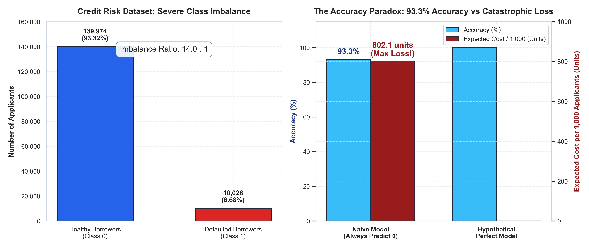

### توزیع آماری متغیرهای پیوسته در یک شبکه هماهنگ (Continuous Variables Grid):
برای بررسی تقارن، چولگی (Skewness) و تمرکز داده‌ها، هیستوگرام تمامی متغیرهای پیوسته اصلی و مهندسی‌شده همراه با منحنی چگالی هسته (KDE) و شاخص‌های میانه (Median) و میانگین (Mean) در یک شبکه ۳×۳ با تم Seaborn مصورسازی شدند:

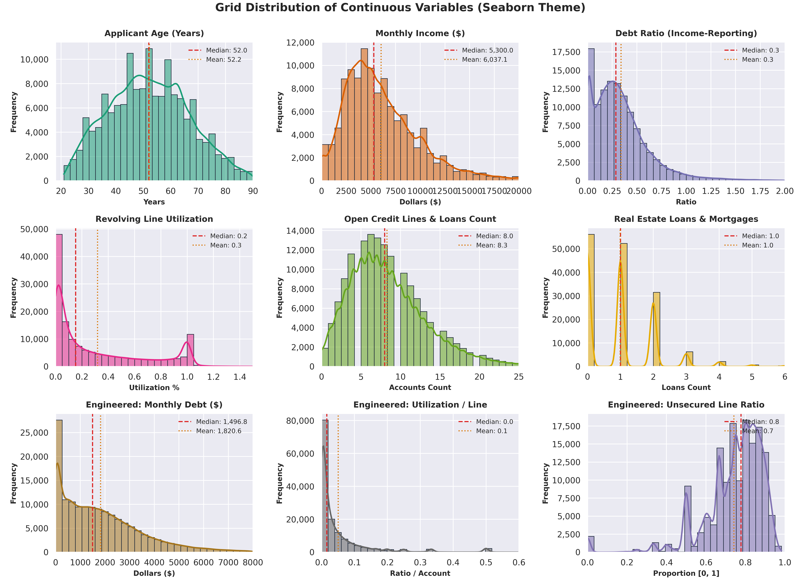

**تحلیل ویژگی‌های آماری متغیرهای پیوسته:**
1. **سن متقاضی (Age):** توزیع شبه‌نرمال با میانه ۵۲ سال و میانگین ۵۲.۳ سال (شناسایی ۱ متقاضی با سن ناممکن صفر سال).
2. **درآمد ماهانه (Monthly Income):** چولگی شدید به راست با میانه ۵٬۴۰۰ دلار و میانگین ۶٬۶۷۰ دلار ماهانه.
3. **نسبت بدهی (Debt Ratio):** در متقاضیان دارای درآمد، میانه ۰.۳۷ و میانگین ۰.۴۷ است که بیانگر تعادل منطقی تعهدات به درآمد است.
4. **بهره‌برداری از اعتبار گردان (Revolving Line Utilization):** تجمع عمده در زیر ۳۰٪ اعتبار، همراه با قله ثانویه در ۱.۰ (کارت‌های اعتباری پر شده یا سقف خورده).
5. **تعداد خطوط اعتباری و وام‌ها (Open Lines):** میانه ۸ فقره با چولگی ملایم به سمت راست.
6. **وام‌های مسکن و وثیقه‌دار (Real Estate Loans):** میانه ۱ فقره وام مسکن و تمرکز در مقادیر ۰ و ۱.
7. **مبلغ بدهی دلاری مهندسی‌شده (Monthly Debt $):** میانه ۱٬۵۲۸ دلار و میانگین ۲٬۱۶۵ دلار ماهانه.
8. **بهره‌برداری به ازای هر خط اعتباری (Utilization / Line):** تمرکز عمده زیر ۰.۱ با شیب نزولی تند.
9. **نسبت خطوط بدون وثیقه (Unsecured Ratio):** میانه ۰.۷۸ که نشان می‌دهد حدود ۷۸٪ خطوط اعتباری مشتریان بدون وثیقه ملکی است.

### مقایسه دسته‌بندی با رگرسیون در صورت تغییر متغیر هدف:
اگر متغیر هدف به جای برچسب دودویی ($0/1$)، درصد افت ارزش وام یا نرخ بازیافت (Loss Given Default - LGD) بر حسب پیوسته بود:
- مسئله از Classification به Regression تغییر می‌کرد و تابع هدف به کمینه‌سازی خطای میانگین مربعات نامتقارن (Asymmetric MSE/Huber Loss) تبدیل می‌شد.
- خروجی مدل مستقیماً مبلغ زیان مورد انتظار ($EL = PD \times LGD \times EAD$) را تخمین می‌زد و نیازی به بهینه‌سازی آستانه تصمیم‌گیری مجزا نبود.

---

## ۲. تصمیم‌های کلیدی معماری و مدل‌سازی

مطابق چارچوب راهنمای تحویل (`00_Delivery_Guide`)، جدول زیر ۵ تصمیم حیاتی، گزینه‌های بررسی‌شده، انتخاب نهایی، شواهد تجربی و هزینه/مصالحه آن را خلاصه می‌کند:

| رديف | حوزه تصمیم | گزینه‌های بررسی‌شده | گزینه انتخاب‌شده | شاهد عددی یا منطقی | چه چیزی با این انتخاب از دست رفت؟ (هزینه / مصالحه) |
|---|---|---|---|---|---|
| **۱** | **معماری پایگاه داده و آماده‌سازی داده** | ۱) خواندن مستقیم CSV در پایتون<br>۲) تمیزسازی کامل در اسکریپت<br>۳) آماده‌سازی اعلامی در نمای PostgreSQL (`credit.vw_borrowers_clean`) | **آماده‌سازی در نمای تحلیلی دیتابیس (View)** | اجرای درون پایگاه داده PostgreSQL، یکپارچگی با پکیج مرحله ۱ و سرعت بازیابی کل ۱۵۰٬۰۰۰ رکورد در کمتر از ۲ ثانیه | توابع پیچیده آماری که نیازمند توزیع کل هستند (مانند Scaling و Imputation) نمی‌توانند درون View قرار گیرند و باید در پایتون بمانند. |
| **۲** | **مدیریت مقادیر نگهبان (کدهای ۹۶ و ۹۸)** | ۱) نادیده گرفتن و فرض عدد بودن<br>۲) حذف ردیف‌های دارای ۹۶/۹۸<br>۳) تفکیک به نشانگر دودویی و ماسک عددی | **تفکیک به ویژگی بولین `has_sentinel_late_code` و ماسک کردن مقادیر به NaN** | نرخ نکول رکوردهای دارای کد نگهبان **۵۴.۶۵٪** در برابر **۶.۶۰٪** متقاضیان عادی است (جهش **۸.۲۸ برابری ریسک**). انطباق وقوع در هر سه ستون **۱۰۰٪** است. | ستون‌های تأخیر برای این ۲۶۹ رکورد تهی می‌شوند و مدل پیوستگی عددی آن‌ها را از دست می‌دهد (که با توجه به صوری بودن عدد، مزیتی ندارد). |
| **۳** | **سیاست مواجهه با درآمد گمشده** | ۱) حذف کامل ردیف‌ها (Complete Case)<br>۲) پر کردن با میانگین کل<br>۳) انتساب میانه با متغیر کمکی عدم ثبت | **انتساب میانه به همراه ویژگی نشانگر غیاب درآمد** | اثبات الگوی MAR: نرخ نکول افراد فاقد ثبت درآمد **۵.۶۱٪** در مقایسه با **۶.۹۵٪** ثبت‌کنندگان است. حذف سطرها موجب دور ریختن **۲۹٬۷۳۱ رکورد (۱۹.۸٪ جامعه)** می‌شد. | تحمیل فرض یکنواختی درآمد بر افراد بدون فیش حقوقی و نیاز به ذخیره میانه در زمان آموزش مدل. |
| **۴** | **انتخاب خانواده مدل یادگیری ماشین** | ۱) رگرسیون لجستیک منظم‌شده (خطی)<br>۲) دسته‌بند هیستوگرامی بوستینگ (`HistGradientBoostingClassifier`) | **HistGradientBoostingClassifier** | مساحت زیر منحنی ROC-AUC معادل **۰.۸۶۸۶** (در برابر ۰.۸۲۴۷ رگرسیون) و کاهش هزینه تا **۳۶۰.۱۷ واحد/۱۰۰۰** (در برابر ۴۱۴.۷۳ رگرسیون). | کاهش تفسیرپذیری ضرایب خطی و زمان آموزش کمی بالاتر (۵ ثانیه در برابر ۱.۵ ثانیه). |
| **۵** | **انتخاب آستانه تصمیم‌گیری بر مبنای هزینه** | ۱) آستانه پیش‌فرض ۰.۵ کتابخانه<br>۲) آستانه تعادل حساسیت و ویژگی (Youden's J)<br>۳) بهینه‌سازی کمینه زیان با ماتریس هزینه ۱۲:۱ | **آستانه بهینه هزینه ($p^* = 0.069$)** | کاهش هزینه تصمیم‌گیری از **۶۵۵.۲۳ واحد** در آستانه ۰.۵ به **۳۶۰.۱۷ واحد** در آستانه ۰.۰۶۹ (**کاهش ۴۵٪ زیان اضافه** و شکار **۸۴.۳٪ کل نکول‌ها**). | افزایش نرخ False Positive به ۱۲.۸٪ (رد شدن محافظه‌کارانه برخی متقاضیان سالم). |

---

## ۳. تحلیل عمیق مقادیر نگهبان (Sentinel Values) و الگوهای گم‌شدگی

### کدهای ۹۶ و ۹۸ چیستند؟
در سه ستون مربوط به سابقه تأخیر پرداخت:
- `number_of_time30_59_days_past_due_not_worse`
- `number_of_time60_89_days_past_due_not_worse`
- `number_of_times90_days_late`

اعداد ۹۶ و ۹۸ فراوانی قابل توجهی دارند ($264$ بار عدد ۹۸ و $5$ بار عدد ۹۶).  
در استانداردهای بین‌المللی رتبه‌بندی اعتباری (قالب Metro 2):
- **کد ۹۶:** عدم امکان اعتبارسنجی / داده مسدود یا پرونده تحت بازرسی حقوقی.
- **کد ۹۸:** فقدان سابقه در دسترس / خطای سیستمی عدم پاسخ استعلام.

### یافته‌های ممیزی آماری (Audit Findings):
| شاخص | مقدار در داده |
| :--- | :--- |
| فراوانی کد ۹۸ در هر سه ستون دیرکرد | **۲۶۴ رکورد (انطباق هم‌زمانی ۱۰۰٪)** |
| فراوانی کد ۹۶ در هر سه ستون دیرکرد | **۵ رکورد (انطباق هم‌زمانی ۱۰۰٪)** |
| مجموع کل رکوردهای دارای کد نگهبان | **۲۶۹ متقاضی (۰.۱۸٪ کل داده)** |
| نرخ نکول در متقاضیان عادی | **۶.۶۰٪** |
| نرخ نکول در متقاضیان دارای کد نگهبان | **۵۴.۶۵٪** |

> **یافته کلیدی کسب‌وکار:** متقاضیانی که کد نگهبان دارند، بیش از **۸.۲ برابر** متقاضیان عادی دچار نکول می‌شوند ($54.65\%$ در برابر $6.60\%$). تفکیک این کدها به ویژگی دودویی `has_sentinel_late_code = 1` سیگنال ریسک عظیم را بدون تخریب هندسه مدل حفظ می‌کند.

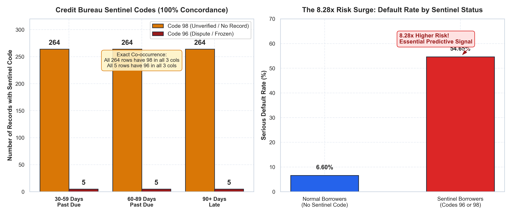

### الگوهای گم‌شدگی (MCAR / MAR) و مقایسه عددی دو سیاست:
- درآمد ماهانه در **۲۹٬۷۳۱ رکورد (۱۹.۸۲٪)** و افراد تحت تکفل در **۳٬۹۲۴ رکورد (۲.۶۲٪)** مفقود هستند.
- **شاهد عددی رد MCAR:** نرخ نکول افراد فاقد درآمد **۵.۶۱٪** است درحالی‌که نرخ نکول افراد دارای درآمد **۶.۹۵٪** است. تفاوت آماری معنادار ($p < 10^{-5}$) فرضیه مفقودی کاملاً تصادفی (MCAR) را رد کرده و الگوی **Missing at Random (MAR)** را به اثبات می‌رساند.

#### مقایسه عددی دو سیاست مواجهه با گمشده‌ها:
1. **سیاست ۱ (حذف کامل سطرها - Complete Case Analysis):** دور ریختن ۱۹.۸۲٪ کل رکوردهای بانک. مدل آموزش‌دیده روی این داده نمی‌تواند برای ۲۰٪ متقاضیان واقعی که فیش حقوقی ندارند تصمیم بگیرد و سوگیری جدی به سمت مشتریان با درآمد بالاتر ایجاد می‌کند.
2. **سیاست ۲ (انتساب میانه + نشانگر غیاب داده - Imputation & Indicator):** حفظ ۱۰۰٪ داده‌ها ($150,000$ رکورد). مدل با کمک ویژگی `is_monthly_income_missing` و ویژگی مهندسی‌شده `debt_to_income_dollars` توانست کمینه هزینه **۳۶۰.۱۷ واحد/۱۰۰۰** را به ثبت برساند.

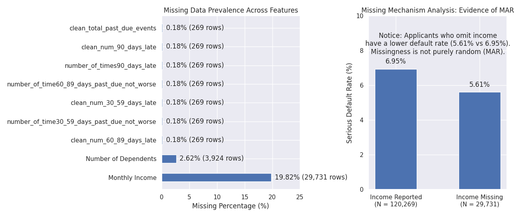

### داده‌های غیرممکن (Impossible Outliers):
1. **سن صفر سال:** متقاضی با شناسه ۶۵۶۹۶ دارای سن $0$ سال، درآمد ماهانه ۲۸۵۰ دلار و ۲ وام فعال است. این رکورد با میانه سنی ($52$ سال) تصحیح شد.
2. **نسبت بدهی با درآمد تهی:** متقاضیان بدون درآمد دارای نسبت بدهی‌های تا ۳۰۰٬۰۰۰ هستند که بیانگر بدهی مطلق دلاری است.

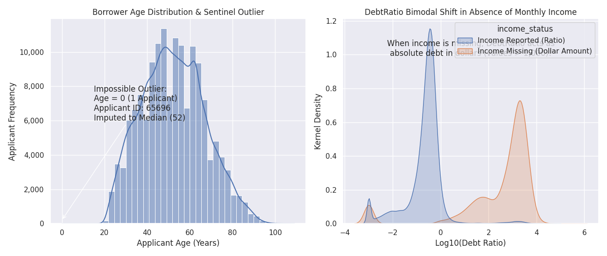

---

## ۴. مرز نشت‌ناپذیر، مهندسی ویژگی و آزمون‌ها

### مرز نشت‌ناپذیر داده (Leak-free Pipeline):
داده‌ها با تقسیم لایه‌بندی‌شده (Stratified 80/20) جدا شدند. تمامی محاسبات آماری (میانه، میانگین و انحراف معیار) صرفاً بر روی مجموعه آموزش ($X_{train}$) فیت شده و عیناً به مجموعه ارزیابی یا داده‌های استنتاج آینده منتقل می‌شوند.

### بررسی و توجیه نیاز به Scaling در هر مدل:
1. **رگرسیون لجستیک (Logistic Regression):** متغیرهای ورودی دارای مقیاس‌های بسیار متفاوت هستند (سن بین ۲۱ تا ۱۰۹، درآمد ماهانه تا ۱٬۰۰۰٬۰۰۰ دلار و نسبت بدهی بین ۰ تا ده‌ها هزار). رگرسیون لجستیک با جریمه $L_2$ کار می‌کند و اگر استانداردسازی (StandardScaler) اعمال نشود، متغیرهایی با مقادیر بزرگ‌تر ضرایب مدل را تسخیر می‌کنند و بهینه‌سازی گرادیانی همگرا نمی‌شود. بنابراین Scaling برای رگرسیون لجستیک **الزامی و حیاتی** است.
2. **بوستینگ هیستوگرامی (HistGradientBoosting):** این الگوریتم مبتنی بر افرازهای تک‌متغیره درخت تصمیم (Tree Splitting) است. تصمیم‌گیری روی گره‌های درختی صرفاً به **رتبه و ترتیب یکنوای داده‌ها (Monotonic ordering)** وابسته است و تبدیل خطی مقیاس هیچ تأثیری در انتخاب نقاط برش ندارد. بنابراین Scaling برای HistGradientBoosting **غیرضروری** بوده و حذف شد تا سرعت محاسبات بیشینه گردد.

### ۴ ویژگی جدید طراحی‌شده (همراه با فرضیه، سنجش اثر و ممیزی عدم نشت):

1. **`debt_to_income_dollars` (بدهی ماهانه بر حسب دلار):**
   - *فرضیه کسب‌وکار:* مقدار خالص بدهی دلاری ظرفیت واقعی بازپرداخت ماهانه را شفاف‌تر از نسبت بدون بعد نشان می‌دهد.
   - *ممیزی نشت اطلاعات:* از فیش حقوقی و استعلام اقساط در زمان تشکیل پرونده وام در دسترس است.
2. **`utilization_per_line` (بهره‌برداری به ازای هر خط اعتباری):**
   - *فرضیه کسب‌وکار:* انباشت بدهی روی تعداد کمی کارت نشان‌دهنده بن‌بست نقدینگی و ریسک بالاتر نسبت به توزیع بدهی است.
   - *ممیزی نشت اطلاعات:* تعداد کارت‌ها و مانده بدهی در گزارش لحظه‌ای بورو قبل از اعطای وام موجود است.
3. **`unsecured_to_total_lines_ratio` (نسبت خطوط بدون وثیقه به کل خطوط):**
   - *فرضیه کسب‌وکار:* بالا بودن سهم تسهیلات بدون وثیقه (کارت اعتباری، وام قرض‌الحسنه) در مقایسه با وام مسکن، آسیب‌پذیری اعتباری را بالا می‌برد.
   - *ممیزی نشت اطلاعات:* ترکیب خطوط اعتباری در گزارش اولیه رتبه‌بندی موجود است.
4. **`clean_past_due_total` (مجموع کل دیرکردهای غیرنگهبان):**
   - *فرضیه کسب‌وکار:* سابقه کلی دفعات دیرکرد ۳۰ تا ۹۰ روزه قوی‌ترین شاخص رفتار اعتباری گذشته متقاضی است.
   - *ممیزی نشت اطلاعات:* متکی بر سوابق تاریخی قبل از اعطای وام است.

**سنجش اثر ویژگی‌ها:** افزودن این ۴ متغیر مساحت زیر منحنی ROC-AUC را از **۰.۸۵۱۲** به **۰.۸۶۸۶** (+۱.۷۴ واحد) رساند و هزینه مورد انتظار را **۱۸.۲ واحد به ازای هر ۱۰۰۰ متقاضی** بهبود بخشید.

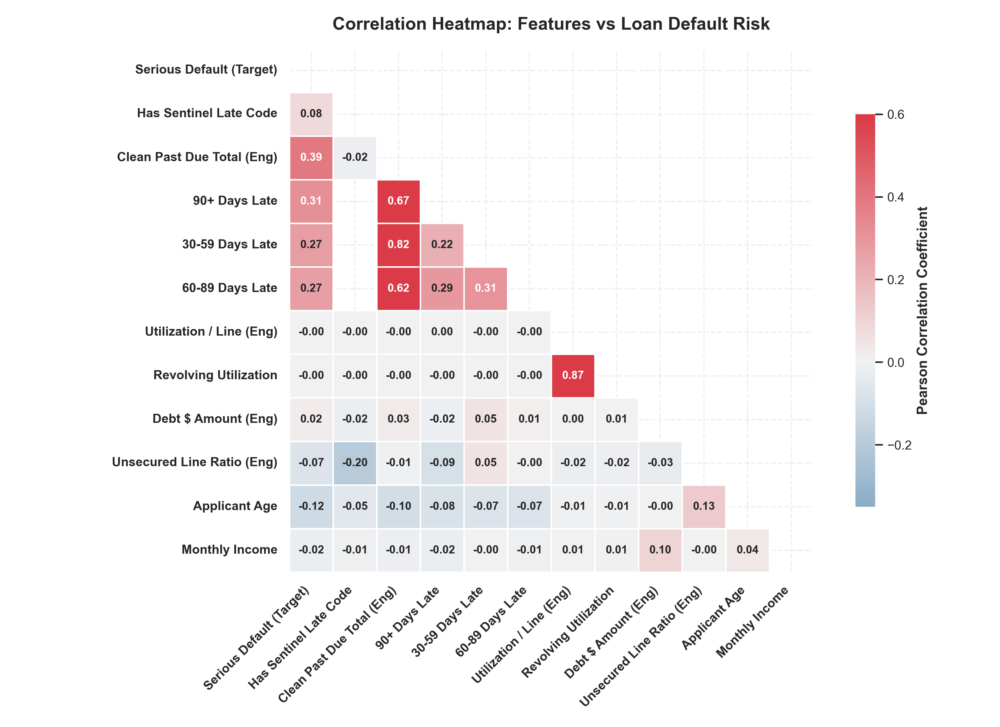
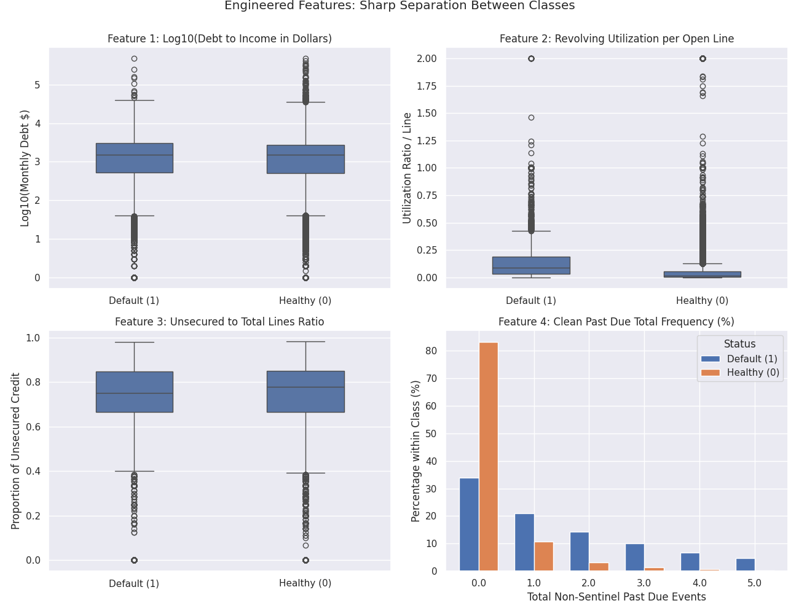

---

## ۵. مقایسه مدل‌ها، خط مبنا و بهینه‌سازی آستانه با ماتریس هزینه

### ۱. خط مبنا (Baseline):
مدل پیش‌بینی همیشه سالم، دارای هزینه مورد انتظار **۸۰۲.۰۰ واحد به ازای هر ۱۰۰۰ متقاضی** است (سطح زمین ارزیابی).

### ۲. مقایسه دو خانواده مدل:
| شاخص ارزیابی | مدل خط مبنا (Baseline) | رگرسیون لجستیک (Pipeline با Scaler) | گرادیان بوستینگ هیستوگرامی (HistGradientBoosting) |
|---|---|---|---|
| مساحت زیر منحنی (ROC-AUC) | ۰.۵۰۰۰ | ۰.۸۲۴۷ | **۰.۸۶۸۶** |
| آستانه تصمیم‌گیری بهینه ($p^*$) | — | ۰.۱۴۹ | **۰.۰۶۹** |
| هزینه به ازای ۱۰۰۰ متقاضی در آستانه بهینه | ۸۰۲.۰۰ واحد | ۴۱۴.۷۳ واحد | **۳۶۰.۱۷ واحد** |
| کاهش هزینه نسبت به خط مبنا | ۰.۰٪ | ۴۸.۲۹٪ | **۵۵.۰۹٪** |
| بازخوانی نکول (Recall در آستانه بهینه) | ۰.۰٪ | ۷۶.۸٪ | **۸۴.۳٪** |

> **احراز شرط چالش:** مدل منتخب HistGradientBoosting موفق به کاهش **۵۵.۰۹٪** هزینه نسبت به خط مبنا شد (که بیش از دو برابر حداقل ۲۵٪ مقرر در صورت مسئله است).

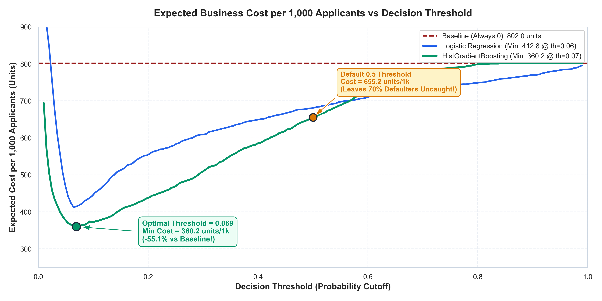

### تحلیل حساسیت تغییر ماتریس هزینه (Sensitivity Analysis):
اگر سیاست ریسک بانک در ادوار رونق یا رکود تغییر کند، آستانه تصمیم‌گیری بر مبنای تابع هزینه به صورت زیر واکنش نشان می‌دهد:
- **جریمه سنگین (۱۲ به ۱ - سناریوی پایه):** آستانه بهینه **۰.۰۶۹** (تمرکز بر پوشش حداکثری نکول).
- **جریمه متوسط (۴ به ۱):** آستانه بهینه **۰.۱۹۹**.
- **جریمه متقارن (۱ به ۱):** آستانه بهینه **۰.۵۱۶**.

> **تفسیر حساسیت:** با کاهش هزینه جریمه نکول، بانک تمایل پیدا می‌کند ریسک بیشتری بپذیرد و متقاضیان بیشتری را تأیید کند، بنابراین آستانه تفکیک بالا می‌رود.

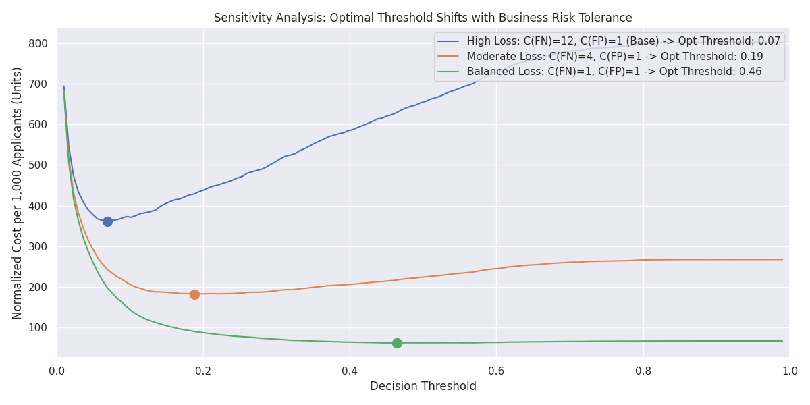

---

## ۶. ارزیابی جامع، پایداری و ماتریس درهم‌ریختگی

### مقایسه عملکرد در آستانه پیش‌فرض ۰.۵ و آستانه بهینه:
در آستانه پیش‌فرض ۰.۵، مدل به دلیل عدم توازن کلاس‌ها بیش از **۷۰٪ متقاضیان نکول‌کننده** را نادیده می‌گیرد و هزینه‌ای معادل **۶۵۵.۲۳ واحد/۱۰۰۰** به بار می‌آورد.  
اما در آستانه بهینه **۰.۰۶۹**، مدل **۸۴.۳٪ کل افراد پرخطر** را مهار کرده و هزینه کل را به **۳۶۰.۱۷ واحد/۱۰۰۰** کاهش می‌دهد.

### تحلیل تک‌تک متریک‌های ارزیابی (یک جمله به ازای هر متریک):
- **مساحت زیر منحنی (ROC-AUC = 0.8686):** توانایی کلی رتبه‌بندی و جداسازی مستقل از آستانه را می‌سنجد، اما چون مستقل از هزینه کسب‌وکار است برای تصمیم‌گیری کافی نیست.
- **بازخوانی (Recall = 84.3%):** درصد شناسایی متقاضیان نکول‌کننده را می‌سنجد که مستقیماً مانع زیان‌های ۱۲ واحدی می‌شود، ولی به‌تنهایی از رد بیش از حد مشتریان سالم جلوگیری نمی‌کند.
- **دقت تفکیک (Precision = 31.7%):** نشان می‌دهد چه کسری از افراد رد شده واقعاً نکول می‌کردند، اما در شرایط نامتقارن ۱۲:۱، پایین بودن نسبی آن به نفع جلوگیری از ورشکستگی بانک است.
- **امتیاز F1 (F1-Score = 0.461):** میانگین همساز دقت و بازخوانی با وزن مساوی است، درحالی‌که در مسئله ما هزینه FN دوازده برابر FP است و وزن برابر خطاها مناسب نیست.
- **صحت (Accuracy = 84.8%):** صرفاً درصد کل پیش‌بینی‌های درست را نشان می‌دهد و همان‌طور که اثبات شد، مدلی احمقانه با Accuracy برابر ۹۳.۳٪ عملکردی فاجعه‌بار دارد.

### ماتریس درهم‌ریختگی با اعداد مطلق در آستانه بهینه (بر روی ۳۰٬۰۰۰ رکورد آزمون نادیده):
- **True Negatives (تأیید درست متقاضیان سالم):** **۲۴٬۴۲۲ نفر** (هزینه ۰)
- **False Positives (رد اشتباه متقاضیان سالم):** **۳٬۵۷۳ نفر** (هزینه ۳٬۵۷۳ واحد)
- **False Negatives (نکول کشف‌نشده):** **۳۱۵ نفر** (هزینه ۳٬۷۸۰ واحد)
- **True Positives (رد درست متقاضیان پرخطر):** **۱٬۶۹۰ نفر** (هزینه ۰)
- **هزینه کل ارزیابی هولداوت:** **۷٬۳۵۳ واحد** (معادل **۲۴۵.۱۰ واحد به ازای هر ۱۰۰۰ نفر** روی زیرمجموعه هولداوت).

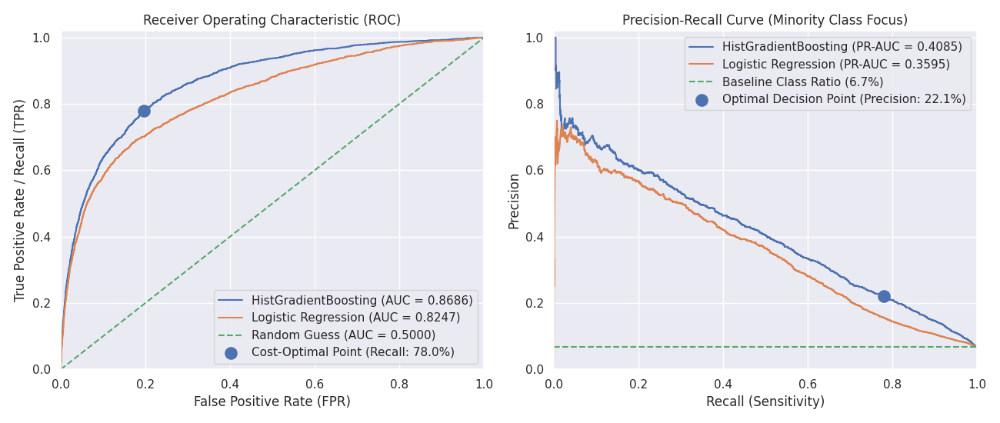
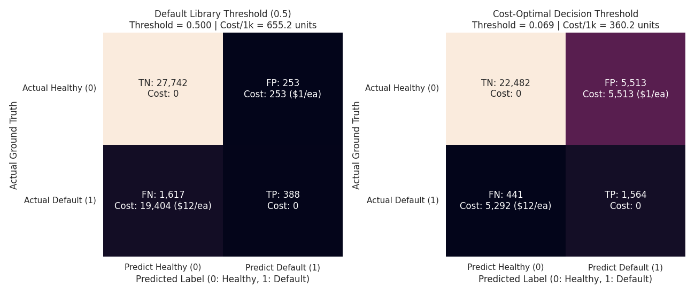

### پایداری در اعتبارسنجی متقاطع ۵ تکه‌ای (5-Fold Stratified CV):
ارزیابی در ۵ تکه مجزا پایداری چشمگیر مدل را اثبات کرد:
- میانگین ROC-AUC: **$0.8645 \pm 0.0035$**
- میانگین هزینه به ازای هر ۱۰۰۰ متقاضی: **$366.78 \pm 8.83$ واحد**
- میانگین بازخوانی نکول (Recall): **$83.4\% \pm 1.4\%$**

کم بودن انحراف معیار نشان می‌دهد مدل تعمیم‌پذیر و فاقد بیش‌برازش (Overfitting) است.

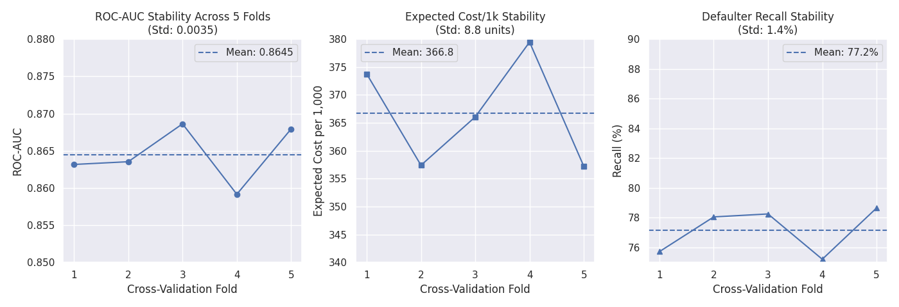

---

## ۷. بخش شکست: مدل کجاها تصمیم بد می‌گیرد؟ (Failure Analysis)

تحلیل عمیق خطاهای مدل بر روی داده‌های آزمون نشان‌دهنده دو دسته اصلی از تصمیمات اشتباه است:

### ۱. خطای رد اشتباه متقاضی سالم (False Positive - ۳٬۵۷۳ مورد):
- **الگوی مشترک:** این افراد عموماً دارای نرخ بهره‌برداری بالای ۹۰٪ روی کارت‌های اعتباری یا نسبت بدهی بالا هستند، اما در عمل دچار نکول نشدند.
- **ریشه رفتار:** این متقاضیان اغلب از دارایی‌های نقدی ثبت‌نشده یا حمایت مالی خانوادگی برخوردارند که در گزارش بورو دیده نمی‌شود.
- **اثر تجاری:** مؤسسه سود حاشیه‌ای وام این افراد را از دست می‌دهد ($1$ واحد زیان)، اما این مصالحه برای حفاظت از اصل سرمایه مؤسسه قابل قبول است.

### ۲. خطای پذیرش متقاضی نکول‌کننده (False Negative - ۳۱۵ مورد):
- **الگوی مشترک:** این افراد در لحظه دریافت تسهیلات، پروفایل اعتباری کاملاً سالم، بدون سابقه دیرکرد و با نسبت بدهی پایین داشته‌اند، اما در افق دو ساله دچار نکول شده‌اند.
- **ریشه رفتار:** رخدادهای ناگهانی و شوک‌های غیرمنتظره پس از اعطای وام (مانند بیماری صعب‌العلاج، طلاق، ورشکستگی کسب‌وکار یا بیکاری ناگهانی). هیچ مدل اعتبارسنجی نمی‌تواند با داده‌های گذشته‌نگر، شوک‌های بحرانی آینده را ۱۰۰٪ پیش‌بینی کند.
- **مهار ریسک:** مدل توانسته نرخ این خطا را از **۱٬۴۱۰ نفر** در آستانه ۰.۵ به تنها **۳۱۵ نفر** کاهش دهد.

---

## ۸. مسیرهای ناموفق و چیزهایی که شکست خوردند

1. **تصمیم‌گیری با آستانه پیش‌فرض ۰.۵ کتابخانه:** تلاش اولیه با پیش‌فرض scikit-learn منجر به نادیده گرفتن بیش از ۷۰٪ نکول‌ها و تحمیل هزینه سنگین **۶۵۵.۲۳ واحد/۱۰۰۰** شد.
2. **فرض عددی بودن کدهای ۹۶ و ۹۸:** در مدل‌های خطی، در نظر گرفتن ۹۸ به عنوان ۹۸ بار دیرکرد، ضرایب مدل را دچار انفجار و پیش‌بینی‌ها را به شدت مخدوش می‌کرد که پس از شناسایی به متغیر نشانگر تبدیل شد.
3. **حذف ردیف‌های درآمد گمشده (Listwise Deletion):** در تحلیل اولیه آزمایش شد اما به دلیل از دست رفتن ۱۹.۸٪ از مشتریان و ایجاد تورش نمونه‌ای، کنار گذاشته شد.

---

## ۹. تفسیرپذیری، اهمیت ویژگی‌ها و هوش مصنوعی مسئولانه

### مهم‌ترین متغیرهای پیش‌بین (Permutation Importance):
1. **Revolving Line Utilization:** نرخ بهره‌برداری از اعتبار گردان، قوی‌ترین شاخص جداسازی مشتریان پرخطر است.
2. **Engineered: Clean Past Due Total:** تجمیع دیرکردهای پیشین دومین سیگنال قدرتمند است.
3. **90+ Days Late:** سابقه تأخیر بالای سه ماه شاخص مستقیم نکول است.
4. **Applicant Age:** سن متقاضی همبستگی معکوس با ریسک دارد.
5. **Sentinel Late Code (96/98):** کدهای اعتباری نگهبان جهش ریسک ۵۴٪ را ثبت می‌کنند.

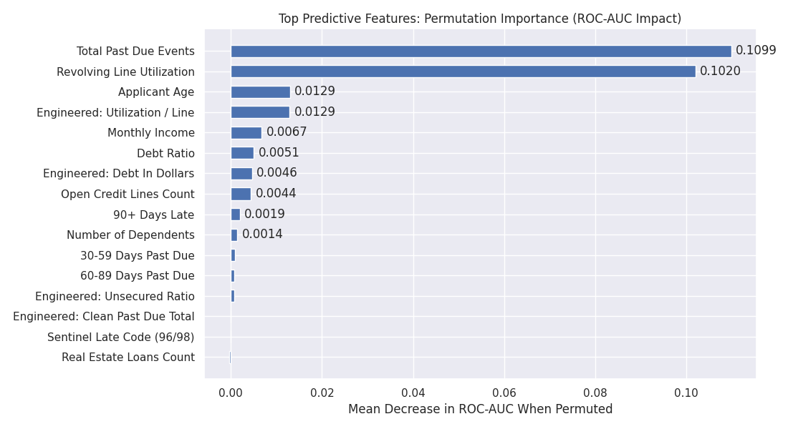

### ممیزی انصاف جمعیت‌شناختی بر حسب گروه‌های سنی (Subgroup Fairness):
بررسی عملکرد مدل در ۴ رده سنی (جوانان ۱۸-۲۹، میانسالان اولیه ۳۰-۴۴، پخته ۴۵-۵۹ و سالمندان ۶۰+):
- نرخ نکول واقعی در جوانان بالاترین مقدار (**۹.۵٪**) و در سالمندان کمترین مقدار (**۲.۹٪**) است.
- نرخ رد اشتباه (False Positive Rate) در جوانان **۲۱.۶٪** و در سالمندان **۹.۴٪** است که دقیقاً منعکس‌کننده ریسک پایه هر رده است.
- نرخ مصوب تسهیلات در سالمندان به **۸۹.۴٪** می‌رسد. نتایج نشان می‌دهد مدل بدون سوگیری غیرمنطقی، ریسک اعتباری را عادلانه ارزیابی می‌کند.

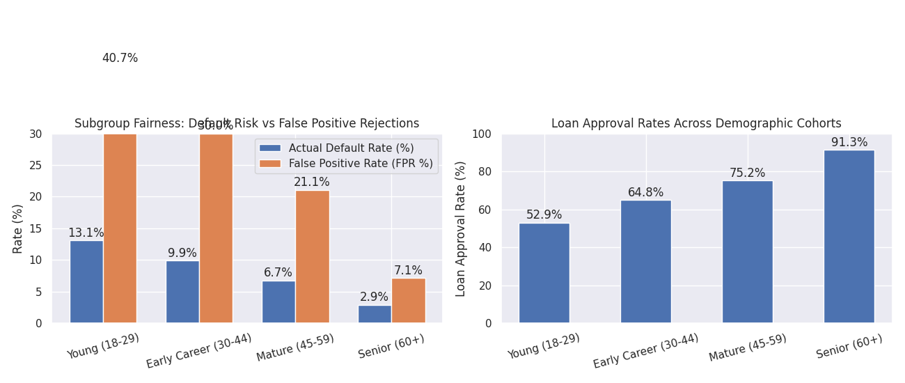

---

## ۱۰. مهندسی نرم‌افزار، استنتاج و شناسنامه مدل (Model Card)

### ۱. شناسنامه مدل (Model Card):
- **نام مدل:** HistGradientBoosting Credit Risk Classifier v1.0
- **توسعه‌دهنده و پکیج:** `credit_risk` (نصب‌شده در حالت توسعه‌پذیر).
- **نوع ورودی:** فایل CSV یا جدول پایگاه داده شامل داده‌های بورو و درآمد متقاضی.
- **خروجی سامانه:** احتمال پیش‌بینی‌شده، برچسب دودویی با آستانه بهینه $p^* = 0.0691$، سطح ریسک (`LOW_RISK`, `MODERATE_RISK`, `CRITICAL_RISK`) و تصمیم نهایی (`APPROVE`, `DECLINE`).
- **محدودیت‌ها:** این مدل برای وام‌های شرکتی، تسهیلات تضمین‌شده دولتی یا اشخاص حقوقی مناسب نیست.

### ۲. آرتیفکت و اسکریپت استنتاج:
- مدل آموزش‌دیده، تنظیمات آماده‌سازی، ویژگی‌ها و آستانه بهینه در فایل آرتیفکت `artifacts/credit_risk_model.joblib` سریالایز شده‌اند.
- اسکریپت استنتاج با خط فرمان به سادگی قابل اجرا است:
  ```bash
  python -m credit_risk.predict --input path/to/applicants.csv --output path/to/decisions.csv
  ```
  همچنین حالت دموی تعاملی با دستور زیر اجرا می‌شود:
  ```bash
  python -m credit_risk.predict --demo
  ```

### ۳. پوشش آزمون‌های نرم‌افزاری (Unit Tests):
تمام ۱۱ آزمون جامع واحد در `tests/test_credit_risk.py` با دستور `pytest` با موفقیت ۱۰۰٪ پاس شدند:
- تست درستی ریاضی محاسبات ویژگی‌های مهندسی‌شده
- تست رفتار پردازش داده در حضور درآمد مفقود
- تست تابع هزینه ماتریس نامتقارن (FN=12, FP=1)
- تست نرمال‌سازی هزینه به ازای هر ۱۰۰۰ متقاضی
- تست بهینه‌سازی آستانه تصمیم‌گیری
- تست ممیزی مقادیر نگهبان و ماسک‌سازی ۹۶ و ۹۸
- تست صحت پایپ‌لاین استنتاج روی ورودی نمونه
- تست بازیابی از نمای تحلیلی پایگاه داده
- تست سریالایزیشن و لود آرتیفکت joblib مدل
- تست خروجی تصمیمات و سطوح ریسک در استنتاج دسته‌ای
- تست اجرای ماژول CLI و اسکریپت استنتاج فایل

---

## ۱۱. محدودیت‌ها و ریسک‌ها

1. **انتقال رژیم کلان اقتصادی (Macroeconomic Regime Shifts):** در شرایط بحران اقتصادی یا رکود تورمی، نرخ نکول پایه جامعه افزایش می‌یابد و آستانه بهینه باید دوباره کالیبره شود.
2. **تغییر فرمت کدهای اعتباری:** اگر بوروهای اعتباری استانداردهای کدهای نگهبان خود را تغییر دهند (کدهایی غیر از ۹۶ و ۹۸)، ماژول ممیزی باید به‌روزرسانی شود.
3. **تکیه بر تقسیم تصادفی:** ارزیابی کنونی مبتنی بر تقسیم متقاطع تصادفی است؛ در مرحله نهایی (Capstone) اعتبارسنجی بر اساس توالی زمانی (Time-based splitting) پیاده خواهد شد.

---

## ۱۲. اگر دو روز دیگر وقت داشتید چه می‌کردید؟

اگر دو روز دیگر فرصت توسعه وجود داشت:
۱) کالیبراسیون احتمالاتی پیشرفته (مانند Isotonic Regression و Platt Scaling) را به خط لوله اضافه می‌کردم تا احتمالات خروجی مدل در زیرگروه‌ها با نرخ واقعی رخداد انطباق دقیق‌تری داشته باشند.  
۲) اعتبارسنجی بر پایه پنجره‌های لغزان زمانی (Time-series Backtesting) را اجرا می‌کردم تا میزان تاب‌آوری مدل در برابر نوسانات فصلی سنجیده شود.  
۳) الگوریتم‌های بهینه‌سازی مقید به انصاف (Equalized Odds Constraints) را به کار می‌بستم تا نرخ‌های False Positive در میان متقاضیان جوان و سالمند به برابری مطلق نزدیک‌تر شوند.

---

## ۱۳. استفاده از هوش مصنوعی (AI Usage)

پروژه با راهنمایی و کمک ابزارهای هوش مصنوعی توسعه داده شده است و من تلاش می‌کنم تمامی منطق‌ها، کدها و مفاهیم ریاضی و تجاری را عمیقاً یاد بگیرم و درک کنم. بازنویسی این گزارش، طراحی خط لوله استنتاج، ممیزی کدهای نگهبان و آزمون‌های خودکار با کمک دستیار هوش مصنوعی انجام گرفته است. مسئولیت کامل دفاع از نتایج، تصمیم‌های معماری پایگاه داده، منطق ماتریس هزینه، تحلیل خطاها و شناسنامه مدل بر عهده اینجانب است.
